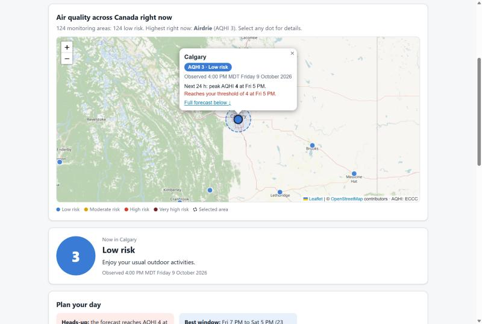

# AirAhead

**When's the best time to be outside today?** AirAhead turns Environment and Climate Change Canada's live Air Quality Health Index (AQHI) forecast into a personal plan: when air quality crosses *your* threshold, and the longest clean-air window in the next 24 hours.

🔗 **Live demo:** https://rameezshahid.github.io/air-ahead/



## The problem

Wildfire smoke seasons are a growing part of Canadian summers. Official tools tell you the air quality *now* and show a forecast, but people with asthma, parents of young children, older adults, outdoor workers and runners have a different question: **"When should I go out, and when should I stay in?"** The same AQHI number means different things to different people, and the official guidance differs for people at higher risk.

## What it does

- **Live data** for 120+ monitoring areas across Canada, straight from Environment Canada's public API (no server in between).
- **An interactive map of Canada:** every area is a dot coloured by its current reading, with a national summary ("124 areas, all low risk; highest right now: …"). Choosing an area, whether on the map, from the list or by your location, highlights it, zooms in, and opens an info popup with the current reading and the next-24-hour peak against your threshold.
- **A personal threshold:** choose *general* or *at higher risk* (children, people over 65, people with heart or lung conditions) and fine-tune the alert level.
- **Plan your day:** the first hour that crosses your threshold, the longest clean-air window, and the daily peak.
- **A 48-hour hourly chart** in the location's local time, plus a multi-day outlook.
- **Nearest-area detection** using your browser's location, which is never stored or sent anywhere.
- **Optional browser notifications** while the tab is open.
- **Shareable links** (`?loc=…&t=…`) so a parent or caregiver can share an exact setup.

## Product thinking

| | |
|---|---|
| 📄 [Product brief](docs/product-brief.md) | Problem, users, competitive landscape (incl. WeatherCAN), assumptions, research plan |
| 📋 [PRD and decision log](docs/prd.md) | Goals, scope, metrics, decisions, roadmap |

Highlights:
- **Planning over alerting.** Environment Canada's WeatherCAN app already sends air-quality notifications. AirAhead deliberately competes on a different job: *planning your day*.
- **Guidance stays faithful to official health messages**, paraphrased with the source linked. No invented health advice.
- **Honest coverage:** Quebec uses its own Info-Smog program, so it isn't covered. That's stated in the app, not hidden.

## Run it locally

```bash
python -m http.server 8000
```

Open http://localhost:8000. The app calls `api.weather.gc.ca` directly; the API allows cross-origin requests.

## Tests

Open [`tests/index.html`](tests/index.html). The tests cover AQHI category bands, the at-risk defaults, using only the latest forecast publication, amended forecasts, ignoring the API's period summaries in the hourly data (a regression found against live data), local-time parsing, threshold detection, best-window detection, nearest-location search, map marker styling, and the national summary.

## Data and licence

Map: [Leaflet](https://leafletjs.com/) with © [OpenStreetMap](https://www.openstreetmap.org/copyright) contributors.

AQHI data © Environment and Climate Change Canada, via [MSC GeoMet / api.weather.gc.ca](https://api.weather.gc.ca/), used under the [Open Government Licence – Canada](https://open.canada.ca/en/open-government-licence-canada). Health guidance paraphrased from [About the AQHI](https://www.canada.ca/en/environment-climate-change/services/air-quality-health-index/about.html).

An independent portfolio project, not affiliated with ECCC. Not medical advice.
